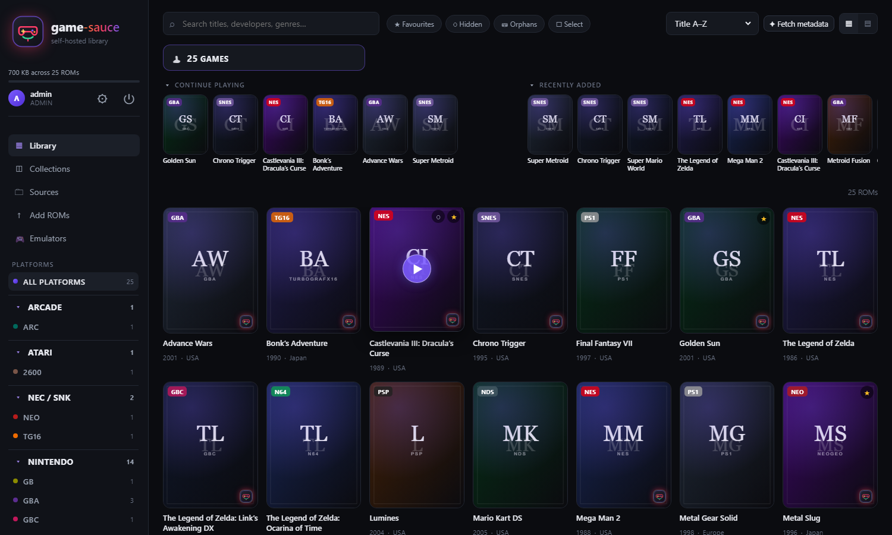
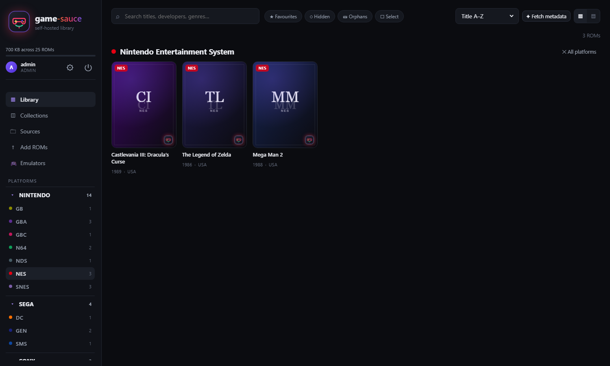
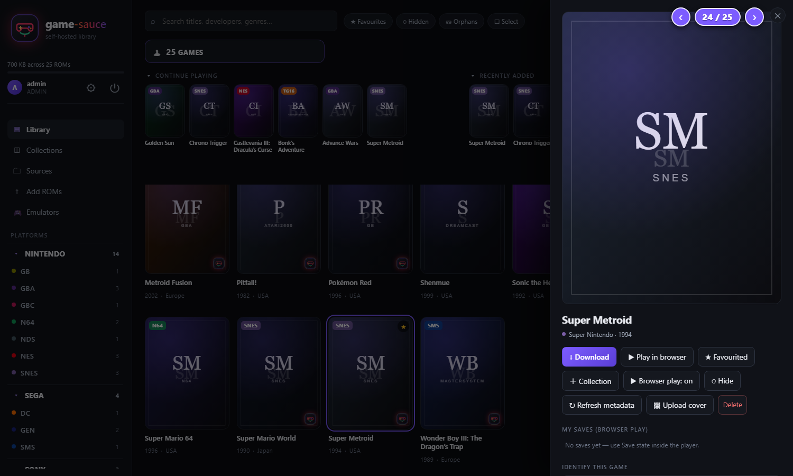
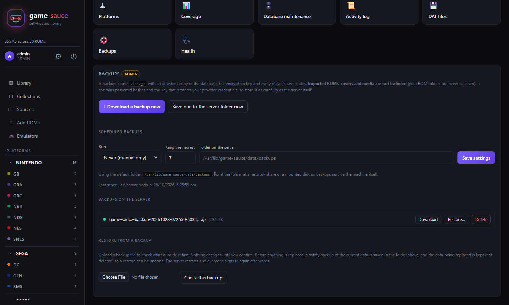
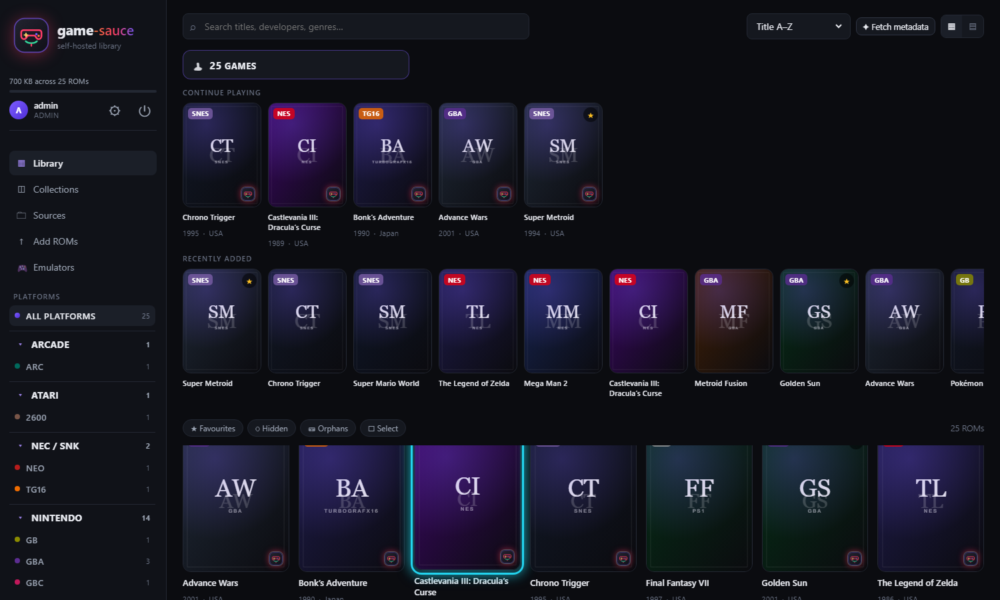
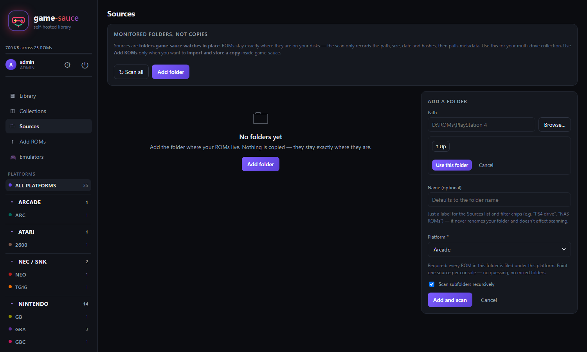
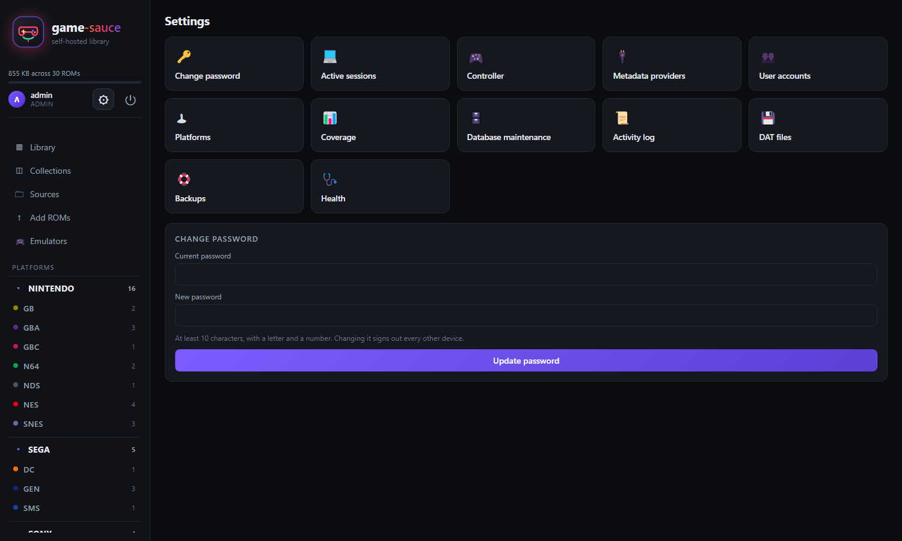
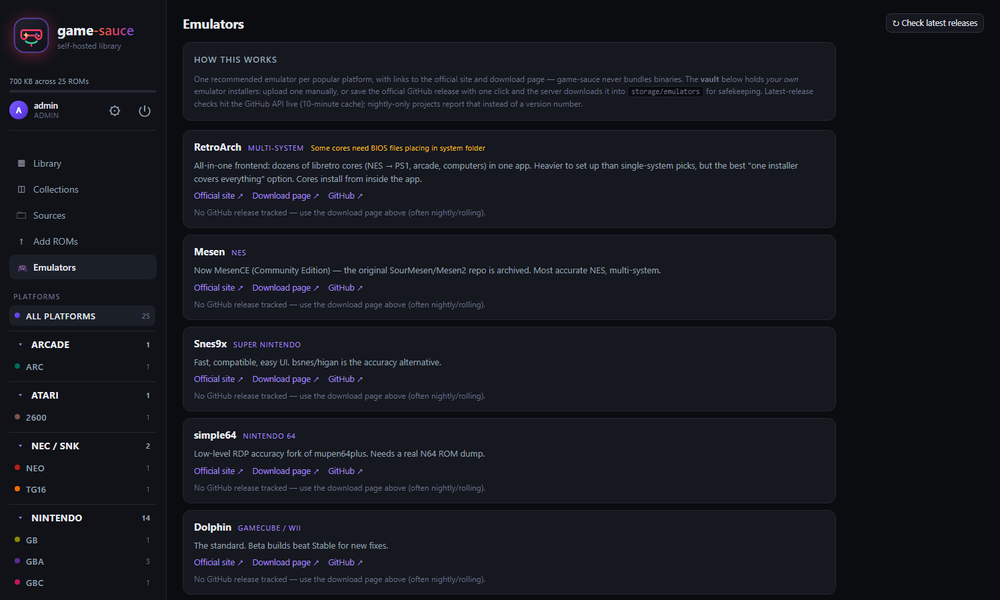
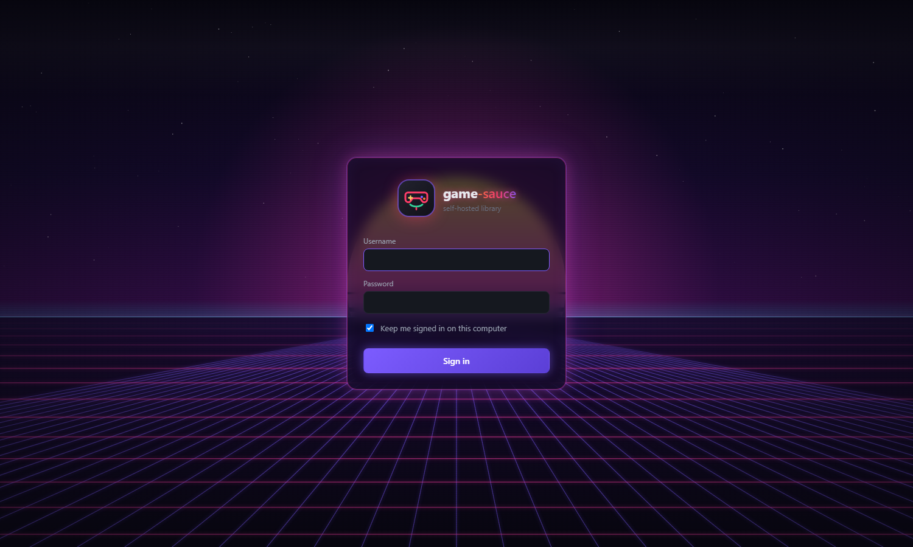

# game-sauce

[](https://github.com/gamesauce-dev/game-sauce/actions/workflows/test.yml)
[](https://github.com/gamesauce-dev/game-sauce/actions/workflows/docker.yml)
[](LICENSE)

A self-hosted ROM manager for **your own collection**: scan folders in place, catalogue your
library, enrich it with metadata and artwork, play many older games in the browser, and download
ROMs back out. Built for a household: you run it, and you give accounts to the people you trust.
Express + SQLite on the server, a single static page on the client, no build step.



**New here? Want to try it on your own computer?** → [Quick start for a desktop](docs/QUICKSTART-DESKTOP.md): install Node.js, download the ZIP, run `./start.sh` (or double-click `start.bat` on Windows). No server, no Docker, no settings to edit.

**Guides:** [Quick start (desktop)](docs/QUICKSTART-DESKTOP.md) · [Deployment](docs/DEPLOYMENT.md) · [User guide](docs/USER-GUIDE.md) · [Changelog](CHANGELOG.md) · [Contributing](CONTRIBUTING.md)

## What it does

- **Scans folders in place.** Your files are catalogued where they are and never moved, renamed or
  deleted. A live progress bar shows each scan; one bad file never stops it.
- **Fetches metadata and covers** from ScreenScraper, TheGamesDB, IGDB and SteamGridDB, or lets you
  upload your own cover.
- **Plays in the browser** (EmulatorJS) for platforms that need no BIOS, with **per-user save states**
  and in-game saves stored on your server. A **Continue playing** row remembers where you were.
- **MAME aware:** import a `-listxml` name list to turn `sf2.zip` into real titles; strict matching
  avoids wrong covers.
- **Verifies dumps** against No-Intro / Redump DATs and shows have/want reports.
- **Collections, favourites, hidden games, users and roles, an activity log.**
- **Runs on PCs and ARM:** the Docker image is published for amd64 and arm64 (Raspberry Pi 4/5, ARM servers).
- **Duplicate finder** (Settings → Duplicate finder): groups different versions of one game (USA / Europe / Japan, revisions, arcade clones), suggests the best copy to keep, and can hide the rest. Nothing is deleted.
- **Health page** (Settings → Health): disk space, database, source reachability, last backup, providers, plus a copy-and-paste report with no secrets for bug reports.
- **One-command Proxmox install:** a single line on the node creates a ready-to-use LXC (no Docker), or use the
  Docker image on any other machine. See [Deployment](#deployment).
- **Backups and restore** built in: download them or schedule them to a folder, and restore from
  a file or straight from the server list. A safety backup is taken first and the replaced data is kept.
- **Controller friendly:** navigate the whole interface with a gamepad, and hold Select + Start to
  close a running game.
- **Tidy Library home:** search and filters on one line, compact collapsible rows for *Continue
  playing* and *Recently added*, and a heading with the platform name when you filter.
- **Scales** from 1080p to 4K, with a retro-neon sign-in screen.

<details>
<summary>More screenshots</summary>

| | |
|---|---|
|  |  |
|  |  |
|  |  |
|  | |



</details>

> Screenshots show the built-in demo data (`npm run seed`); the placeholder covers are generated, not real artwork.

```bash
npm install
npm run seed     # optional: 25 demo entries so the UI has something to show
npm start        # http://127.0.0.1:8080
```

Node 20+. Data lives in `data/gamesauce.db`; imported files and cached artwork live in `storage/`.

## How it stores your ROMs

Two modes, and the difference matters:

- **In place** (what sources do). You point game-sauce at a folder; it walks it, records each
  file's absolute path verbatim, and never copies, moves or renames anything. Deleting a ROM
  from the library does not delete your file unless you explicitly ask
  (`DELETE /api/roms/:id?delete_file=1`).
- **Imported** (what the upload endpoint does). The file is moved into
  `storage/roms/<platform>/<sha1[:2]>/<sha1>.<ext>` — content-addressed, so re-uploading the
  same file dedupes instead of duplicating it.

## Add ROMs vs Sources (which one do I want?)

- **Add ROMs** = **copy into the library**. Drop files (or a folder of files) in the dropzone and
  game-sauce hashes each file, rejects duplicates, and **moves a copy** into
  `storage/roms/<platform>/<sha1>/…`. Your original file stays wherever it was; the library keeps
  its own copy. Best for one-off additions. Tiles can be multi-selected (`☐ Select`) and deleted
  together; in-place files are never touched by bulk delete.
- **Sources** = **watch in place, move nothing**. Register a folder on any of your drives and the
  scan only records path + size + date + hashes, then fetches metadata. Rescans hash only what
  changed; a file on an unplugged drive is flagged `missing`, never deleted. Best for a big
  multi-location collection you already organise yourself.
- **Orphans**: deleting a source with "keep ROMs" leaves catalogue rows with no folder — they
  still show in the library and platform list but can never be re-scanned. Find them with the
  `⛁ Orphans` pill or Metadata → Database maintenance → Show orphans, and purge them there.

## Sources (multiple folders)

```
POST   /api/sources              { path, name?, platform_hint?, recursive?, ignore_globs? }
GET    /api/sources
PATCH  /api/sources/:id          { enabled?, recursive?, platform_hint?, name?, ignore_globs? }
DELETE /api/sources/:id[?remove_roms=1]
POST   /api/sources/:id/scan     { hash?: true }
POST   /api/sources/scan         scan every enabled source
GET    /api/sources/:id/log
GET    /api/sources/roots        drives that exist on this machine
GET    /api/sources/browse?path= server-side folder picker for the UI
```

Scanning is incremental. Each row stores the size and mtime it was catalogued at, so a rescan
only hashes files that are new or changed. Files that vanish are flagged `missing = 1`, not
deleted — an unplugged drive is not a delete. Unchanged files still get their filename
metadata re-derived, so parser fixes reach the existing catalogue.

### How a file's platform is decided

`.iso`, `.chd`, `.cue`, `.pkg` and `.nsp` are shared by many consoles, so guessing is unsafe.
Resolution order:

1. **Source hint** — you pinned the folder to one platform.
2. **Folder names** — `PlayStation 5`, `PS4`, `Xbox 360`, `Switch`, `Sony`, `Nintendo`… plus
   common aliases (`megadrive`, `psx`, `gc`, `vita`, `tg16`, …).
3. **Unambiguous extension** — `.sfc` → SNES, `.vpk` → Vita, `.xex` → Xbox 360.
4. **One candidate left** after alias expansion.
5. Otherwise **Other**, with the candidate list recorded so you can re-file it.

## Platforms

55 platforms with family grouping, ScreenScraper system ids and TheGamesDB ids — now
including Sega Model 2, Model 3, NAOMI and Atomiswave for arcade collectors:

- **Nintendo** — NES, SNES, N64, GameCube, Wii, Wii U, Switch, Switch 2, GB, GBC, GBA, DS, 3DS,
  Virtual Boy, Pokémon Mini
- **Sony** — PS1, PS2, PS3, PS4, PS5, PSP, PS Vita
- **Microsoft** — Xbox, Xbox 360, Xbox One, Xbox Series X|S
- **Sega** — Genesis/Mega Drive, Master System, Game Gear, Sega CD, 32X, Saturn, Dreamcast,
  Model 2, Model 3, NAOMI, Atomiswave
- **Atari** — 2600, 5200, 7800, Lynx, Jaguar
- **NEC/SNK/other** — TurboGrafx-16/PC Engine, PC Engine CD, Neo Geo, Neo Geo Pocket, WonderSwan,
  3DO, CD-i, Arcade, MAME, FinalBurn Neo, ScummVM, DOS

The ScreenScraper ids are best-effort. `GET /api/metadata/screenscraper/systems` checks every one
against the live API and reports any that do not resolve, so a stale id is visible rather than
silently returning the wrong game.

Need something else? **Metadata → Platforms** (admin only) lists every platform with its
extensions and provider ids — add your own (e.g. a new arcade board) with name, slug,
extensions and any known provider ids, or fix an id/ext list in place. Changes take effect
immediately: the next scan and lookup read the database, not the code. Deleting a platform
that still has ROMs moves them to Other (with a confirmation showing the count).

## Emulators

New sidebar section. One recommended emulator per popular platform (20 picks:
Mesen, Snes9x, simple64, Dolphin, Cemu, Eden, mGBA, melonDS, Azahar, DuckStation,
PCSX2, RPCS3, PPSSPP, BlastEm, Mednafen, Flycast, MAME + FBNeo, Stella, xemu,
shadPS4) with official-site + download-page links, the GitHub repo where one
exists, a BIOS/keys warning where one is needed, and a live
`GET /api/emulators/latest/:platform` check (GitHub API, 10-minute cache) with a
per-OS asset picker. **Save to vault** (admin) downloads the official release
asset server-side into `storage/emulators`; manual upload also supported
(`POST /api/emulators/vault/upload`, multipart, 1 GB cap, deduped by SHA1).
Anyone signed in can read the guide and download from the vault; only admins can
add or remove vault entries. game-sauce never bundles or auto-fetches binaries —
every file in the vault got there by an explicit admin action.

```
GET    /api/emulators/guide                  curated picks
GET    /api/emulators/guide/:platform        one pick + platform list
GET    /api/emulators/latest/:platform       live GitHub latest release + assets
GET    /api/emulators/vault                  your stored installers
GET    /api/emulators/vault/:id/download     download a vault file
POST   /api/emulators/vault/upload           multipart { file, name?, platform_slug?, version?, os?, notes? } (admin)
POST   /api/emulators/vault/from-release     { platform, asset? } — fetch official release into the vault (admin)
DELETE /api/emulators/vault/:id              remove entry + file (admin)
```

## DAT files (offline verification)

A DAT is a No-Intro / Redump / TOSEC catalogue of every known-good dump with its exact size,
CRC32, MD5 and SHA1. Importing one lets game-sauce verify ROMs **locally** — no API calls, no
quota — and replace a guessed filename with the canonical title, region and revision. The
**Have/want** button on any imported DAT then shows the reverse side: every entry the DAT lists,
flagged have/missing against your library, with search and paging.

```
GET    /api/dats                     list DATs + coverage + platform list
POST   /api/dats                     { path }  or multipart field `dat` (+ optional `platform`)
DELETE /api/dats/:id
POST   /api/dats/rematch             { platform?, force? }
GET    /api/dats/:id/coverage
GET    /api/dats/:id/have-want?want=missing|have|all&q=&limit=&offset=
GET    /api/roms?dat_status=verified|bad|variant|not-in-dat
GET    /api/roms?orphan=only                      rows with no valid source (hidden included)
GET    /api/roms?hidden=only|all                 default hides hidden rows
DELETE /api/roms?dry_run=1                       ADMIN: count orphaned rows (default)
DELETE /api/roms?dry_run=0                       ADMIN: purge orphans (rows; in-place files never touched)
DELETE /api/roms?dry_run=0&delete_file=1        ADMIN: purge orphans + delete imported copies from storage
```

How matching works:

1. Look up by **SHA1**; if that misses, by **CRC32 + size**; CRC32 alone only when every
   candidate agrees (CRC32 collides across a large enough set).
2. A hit sets `roms.dat_status` (`verified`, `bad`, `variant`) and records the canonical title.
3. The canonical title is applied **only when the current title came from a filename**. A
   provider title or one you edited by hand is never overwritten — `force: true` is the
   deliberate opt-out for that.
4. `not-in-dat` is a real answer too: it means the hash is not in any imported set, so the ROM is
   a hack, a translation, a private dump, or simply from a system whose DAT you have not imported.
5. Importing a newer DAT version adds only the entries it is missing; duplicates are skipped by
   hash rather than by row id.

Parsing is streamed (`saxen`), so a 40 MB DAT does not sit in memory. Files are `.dat`/`.xml`,
up to `GAMESAUCE_MAX_DAT` (512 MB). The DAT itself is not stored — only the catalogue.

`node scripts/make-sample-dats.mjs ../demo-roms sample-dats` generates small real-format DATs
matching the demo library, for trying the feature without downloading a full set.

## Metadata

Two layers:

1. **Filename parsing** (always on, offline). Handles No-Intro, GoodTools and scene naming:
   regions, revisions, years, `[!]` noise tags, `(Japan, USA)` multi-region (USA wins),
   `Sonic.The.Hedgehog.2.USA` dot-separated dumps, `_` separators. Dots inside real titles
   (`Super Mario Bros. Wonder`, `Dr. Mario`) are left alone.
2. **Providers** — ScreenScraper, TheGamesDB, IGDB and LaunchBox, keyed by hash first (CRC32/MD5/SHA1)
   and by name only as a fallback. ScreenScraper lookups run only once all four credential fields are
   set; with a half-filled form it stays inert and the tiles keep their filename titles.
   **LaunchBox** needs no key: an admin downloads its public database once (Settings → System setup →
   Metadata providers, about 110 MB) and lookups are then local and instant. It matches by exact name only,
   so on consoles it is asked first and never gives a sequel's data to the original game.
   SteamGridDB is art-only: it never supplies titles, it only fills in a missing cover after
   a metadata match.

### Where the tiles' artwork comes from

### Entering credentials in the UI

/** Metadata → Accounts** asks for your normal **account username + password** (always required —
this is your quota and identity) plus **developer ID + developer password**.

- **Shared dev pair?** If whoever runs this server baked one in (`SS_DEV_ID_SHARED`),
  the card says so and you leave the two Developer fields empty. Same login, slower
  shared quota, no setup needed. Otherwise **all four fields are required** — leaving the
  Developer fields blank cannot work, and Test connection tells you exactly that.
- **No pair of your own?** Get a free one with a request in the
  [ScreenScraper forum](https://www.screenscraper.fr/forumsujets.php?frub=12) any time for
  your own faster quota — just type it in and save. The card shows whether you are on
  `shared default`, `stored (yours)`, or `not set` per field.
- **IGDB (recommended if ScreenScraper is blocked):** free Twitch developer app → Client ID +
  Client Secret, no approval wait. Best catalogue for modern systems; covers included.
- **SteamGridDB:** free key from your profile page (sign in with Steam → Preferences → API).
  Art only — used automatically as a cover fallback when a metadata match has no art.
- There is a **Test connection** button per provider that spends one request
and reports the result, including how much of today's ScreenScraper quota is used.

Why the dev pair exists at all: ScreenScraper's API authenticates on `devid/devpassword`
**and** `ssid/sspassword` together, and its 403 body
(`Vérifier les identifiants utilisateurs`) blames "the login" even when it is the developer pair
that is missing. If Test connection 403s while your site login is right, the dev half is
almost always the culprit.

- Credentials are encrypted at rest with **AES-256-GCM**. The key comes from `GAMESAUCE_SECRET_KEY`
  when set; otherwise a random key is generated into `data/secret.key` (mode 0600). That protects
  against someone reading a copy of `gamesauce.db`, **not** against someone with access to the whole
  data folder — the UI says so, and setting `GAMESAUCE_SECRET_KEY` removes the caveat.
- Secrets are never returned by the API; the UI only learns whether a value is set.
- Environment variables win over stored values, and a field pinned by the environment is
  rejected rather than silently ignored.
- Only admins can read or write the provider config.

```
GET    /api/metadata/providers        state (secrets masked)
PUT    /api/metadata/providers        { fields: { SS_DEV_ID, SS_DEV_PASSWORD, SS_USER, SS_PASSWORD } }   empty string clears a field
DELETE /api/metadata/providers        clear everything stored
POST   /api/metadata/providers/test   { provider: 'screenscraper' | 'thegamesdb' | 'igdb' | 'steamgriddb' }
POST   /api/metadata/search           { q, platform?, provider?: 'thegamesdb' | 'igdb' }  → candidates + cover flags
POST   /api/metadata/:id/apply        { candidate } — apply a picked row verbatim
```

Environment variables still work for deployment without the UI (they win over stored values):

```bash
export SS_DEV_ID=...            # your own ScreenScraper dev pair (beats the shared default)
export SS_DEV_PASSWORD=...
export SS_DEV_ID_SHARED=...     # baked-in shared default for everyone (distributor use)
export SS_DEV_PASSWORD_SHARED=...
export SS_USER=...              # your screenscraper.fr username
export SS_PASSWORD=...          # your screenscraper.fr password
export IGDB_CLIENT_ID=...       # Twitch developer app (free, minutes, no approval wait)
export IGDB_CLIENT_SECRET=...
export TGDB_API_KEY=...         # optional: https://thegamesdb.net/
export SGDB_API_KEY=...         # optional: SteamGridDB profile → Preferences → API (art fallback)
export GAMESAUCE_SECRET_KEY=...    # encrypts credentials entered in the UI
```

Environment variables still work for deployment without the UI (they win over stored values):

```bash
export SS_DEV_ID=...            # ScreenScraper developer ID (forum → "API")
export SS_DEV_PASSWORD=...      # ScreenScraper developer password
export SS_USER=...              # your screenscraper.fr username
export SS_PASSWORD=...          # your screenscraper.fr password
export TGDB_API_KEY=...         # optional: https://thegamesdb.net/
export GAMESAUCE_SECRET_KEY=...    # encrypts credentials entered in the UI
```

Requests to ScreenScraper are serialised through a queue with a minimum gap
(`SS_MIN_INTERVAL_MS`, default 1200 ms) because it throttles per account, and results are cached
in `metadata_cache` for a week (`META_CACHE_TTL_HOURS`) so rescans and bulk refreshes do not
burn quota. Every outgoing request carries all four auth parameters
(`devid/devpassword` + `ssid/sspassword`) — half-authenticated calls are the 403 the Test
connection button flags. Covers, screenshots, fanart, wheels, manuals and videos are downloaded once into
`storage/media/` and served from there, so the library still looks right when the provider is
unreachable.

```
GET  /api/metadata                                    provider status + coverage counts
POST /api/metadata/:id/refresh                        re-look-up one ROM
POST /api/roms/bulk/enrich                            { ids?, limit?, only_missing_covers? }
GET  /api/metadata/screenscraper/account              quota left today
GET  /api/metadata/screenscraper/systems              verify platform id mapping
GET  /api/roms/:id/media/:kind                        cached artwork
```

## API

```
GET    /api/health
GET    /api/platforms
GET    /api/stats
GET    /api/roms?q=&platform=&family=&source=&genre=&region=&tag=&favorite=&missing=&sort=&limit=&offset=
GET    /api/roms/facets
GET    /api/roms/:id
GET    /api/roms/:id/cover
GET    /api/roms/:id/download
POST   /api/roms/:id/favorite
PATCH  /api/roms/:id
POST   /api/roms/:id/cover
POST   /api/roms/upload            multipart, field name `roms`
POST   /api/roms/bulk/delete       { ids: [...] } — rows + tags/collections/covers; imported files too, in-place never
DELETE /api/roms/:id[?delete_file=1]  single delete; in-place files survive unless delete_file=1
GET    /api/collections
POST   /api/collections
GET    /api/collections/:id
PATCH  /api/collections/:id
DELETE /api/collections/:id
POST   /api/collections/:id/roms        { rom_ids: [] }
DELETE /api/collections/:id/roms/:romId
```

`sort` accepts `title`, `-title`, `added`, `-added`, `year`, `-year`, `rating`, `-size`.

## Deployment

The app is one Node process plus one SQLite file — no separate database, no build step.

| I have… | Use |
|---------|-----|
| **Proxmox VE** | [Option P: one-command LXC installer](#option-p--proxmox-lxc-one-command-no-docker) |
| Any PC or server with Docker | [Option A: Docker](#option-a--docker-recommended-for-another-pcserver-works-on-windows--linux--macos) |
| **Just trying it on your own computer** (no server) | [Quick start for a desktop](docs/QUICKSTART-DESKTOP.md): one command, `./start.sh` |
| Just Node on Windows / Linux / macOS | [Option B: bare Node](#option-b--bare-node-windows-11-linux-macos) |

### Option P — Proxmox LXC (one command, no Docker)

On the **Proxmox node**, as root:

```bash
bash -c "$(curl -fsSL https://raw.githubusercontent.com/gamesauce-dev/game-sauce/main/install/proxmox-lxc.sh)"
```

It shows what it is about to do and asks before it does it, then creates a small unprivileged
Debian 12 container, installs Node 22 and game-sauce, generates an admin password (printed once at
the end), and runs the app as a systemd service that starts on boot. Open `http://<container-ip>:8765`.
Read the script first if you like: [`install/proxmox-lxc.sh`](install/proxmox-lxc.sh).

Everything has a default. Override any of these by putting them in front of the command, for example
`CTID=120 RAM=2048 DISK=16 ROMS=/mnt/pve/nas/roms bash -c "..."`:

| Setting | Default | Meaning |
|---------|---------|---------|
| `CTID` | next free id | Container id |
| `CT_NAME` | `game-sauce` | Container hostname |
| `CORES` / `RAM` / `DISK` | 2 / 1024 MB / 8 GB | Resources |
| `STORAGE` / `TEMPLATE_STORAGE` | `local-lvm` / `local` | Where the disk and the Debian template live |
| `BRIDGE` | `vmbr0` | Network bridge (DHCP) |
| `APP_PORT` | `8765` | Web port |
| `ROMS` | none | Host folder to bind-mount **read-only** at `/roms` in the container |
| `YES=1` | off | Skip the confirmation prompt |

Day to day:

```bash
pct exec <id> -- /usr/local/bin/game-sauce-update      # update to the latest version
pct exec <id> -- systemctl restart game-sauce          # restart
pct exec <id> -- journalctl -u game-sauce -n 50        # logs
```

Data lives in `/var/lib/game-sauce` inside the container and the settings in `/etc/game-sauce.env`;
include the container in your normal Proxmox backups, and use **Settings → Backups** for app-level ones.
Add your ROM folder as a *Source* (point it at `/roms` if you used `ROMS=`). More detail:
[Deployment → Proxmox](docs/DEPLOYMENT.md#35a-running-on-proxmox).

### Option A — Docker (recommended for another PC/Server, works on Windows / Linux / macOS)

What you need on the target machine, and nothing else:

1. **Docker.** Windows/macOS: install [Docker Desktop](https://www.docker.com/products/docker-desktop/)
   and start it. Linux: Docker Engine + the Compose plugin
   (`docker compose version` should print a version).
   > Proxmox: run Docker inside a small Debian/Ubuntu **VM**, not on the PVE host itself.
   > Inside an LXC container Docker also works, but only with *nesting* (and usually
   > *keyctl*) enabled; an unprivileged LXC without them fails in odd ways.
   > See [Deployment → Proxmox](docs/DEPLOYMENT.md#35a-running-on-proxmox).
2. **This project folder** copied over (USB stick, network share, `git clone`, `scp -r`, …).
   It must contain: `Dockerfile`, `docker-compose.yml`, `env.example`, `package.json`,
   `package-lock.json`, `src/`, `public/`, `scripts/`. (`node_modules/`, `data/`, `storage/`,
   `shots/` are excluded from the image automatically via `.dockerignore`.)
3. About 600 MB free for the `node:22-bookworm-slim` base image plus build tools on first build.

Then, on the target machine, in that folder:

```bash
# 1. Create your config from the template and edit it:
cp env.example .env        # Windows (cmd):  copy env.example .env
#    open .env and set at least:
#      GAMESAUCE_ADMIN_USER / GAMESAUCE_ADMIN_PASSWORD   (first admin, min 10 chars)
#      GAMESAUCE_SECRET_KEY                              (openssl rand -base64 32)

# 2. Build the image and start the container in the background:
docker compose up -d --build

# 3. Watch the first-run log (it prints the admin account the first time):
docker compose logs -f game-sauce
#    expect:  game-sauce listening on http://0.0.0.0:8080 (inside the container)

# 4. Sanity check from the host:
curl http://localhost:8765/api/health
#    expect:  {"ok":true,"roms":0,"users":1,...}

# 5. Open http://<server-ip>:8765 in a browser and sign in.
```

How to tell the deploy succeeded:

- `docker compose ps` → `game-sauce` shows `Up` and `(healthy)` after ~15–30 s.
- `curl http://localhost:8765/api/health` returns `{"ok":true,...}`.
- The browser shows the game-sauce login screen.
- If it didn't come up: `docker compose logs game-sauce` tells you why (bad env value,
  port already in use, out of disk). Common fix: `docker compose down && docker compose up -d --build`.
- `gyp ERR! find Python ... Could not find any Python installation` during the build means
  better-sqlite3 had no prebuilt binary for the image's Node version and fell back to compiling.
  The current Dockerfile already installs `python3 make g++` for exactly this case — if you still
  see it, you're building from an older copy of the Dockerfile; re-copy the folder and rebuild.

What lives where:

- `gs-data` volume → `/app/data`: `gamesauce.db` + `secret.key`. Back this up; it is your users, library index and encrypted provider credentials.
- `gs-storage` volume → `/app/storage`: imported ROMs, cached covers/media. Back this up too if re-scanning would be painful.
- Your own ROM folders stay on the host. To let the container *scan* them, add a read-only
  mount to `docker-compose.yml` and re-run `docker compose up -d`:

  ```yaml
  volumes:
    - /mnt/roms:/roms:ro        # Linux server example
    # - C:/ROMs:/roms:ro        # Windows server example (uncomment instead)
  ```

  Then add `/roms/...` as a source in the UI. Sources mounted `:ro` can never be modified
  by the app.

To stop: `docker compose down`. Data survives in the named volumes. To wipe everything including
data: `docker compose down -v` (you will lose the library index — only do this on purpose).
To pull in new code later: copy the folder over again, then `docker compose up -d --build`.

### Option B — bare Node (Windows 11, Linux, macOS)

Prerequisites: Node.js 20+.

```bash
cd game-sauce
npm ci --omit=dev
```

Windows (PowerShell):

```powershell
$env:HOST = "127.0.0.1"
$env:PORT = "8099"
$env:GAMESAUCE_ADMIN_USER = "admin"
$env:GAMESAUCE_ADMIN_PASSWORD = "pick-something-long-1"
$env:GAMESAUCE_SECRET_KEY = "paste-a-long-random-string-here"
node src/server.js
```

Linux / macOS (bash):

```bash
export HOST=127.0.0.1 PORT=8099
export GAMESAUCE_ADMIN_USER=admin
export GAMESAUCE_ADMIN_PASSWORD='pick-something-long-1'
export GAMESAUCE_SECRET_KEY='paste-a-long-random-string-here'
node src/server.js
```

Notes:

- First boot with no admin in the DB prints (once) the generated password, or uses
  `GAMESAUCE_ADMIN_USER` / `GAMESAUCE_ADMIN_PASSWORD` if you set them. Change it after signing in.
- Bind `HOST=127.0.0.1` for local-only, `HOST=0.0.0.0` to serve your LAN. If you bind to anything
  other than localhost, put TLS in front (reverse proxy) and set `GAMESAUCE_COOKIE_SECURE=1` +
  `GAMESAUCE_TRUST_PROXY=1` so session cookies stay Secure and client IPs log correctly.
- Keep the `data/` directory private (it holds password/token hashes) and back it up with
  `storage/` if re-importing would hurt.
- To run on boot: Windows → Task Scheduler or NSSM; Linux → a systemd unit; macOS → launchd.
  All three just re-run `node src/server.js` in this folder with the same env.

### Environment variables (all platforms, Docker included)

| Variable | Purpose |
|---|---|
| `HOST` / `PORT` | bind address / port (default `127.0.0.1` / `8080`) |
| `GAMESAUCE_DATA_DIR` | where `gamesauce.db` + `secret.key` live (default `./data`) |
| `GAMESAUCE_STORAGE_DIR` | where imported ROMs + cached media live (default `./storage`) |
| `GAMESAUCE_ADMIN_USER` / `GAMESAUCE_ADMIN_PASSWORD` | first-run admin (min 10 chars, letter + number) |
| `GAMESAUCE_SECRET_KEY` | key for encrypting stored provider credentials (recommended in production) |
| `GAMESAUCE_RESTART` | how a restore restarts the server: `exit` (let systemd/Docker restart it; the default when either is detected) or `manual` (you restart it yourself) |
| `GAMESAUCE_MAX_RESTORE` | largest backup file the restore page accepts, bytes (default 2 GB) |
| `GAMESAUCE_MAX_STATES` | save states kept per user per game (default 10) |
| `GAMESAUCE_MAME_PLAY_MAX_YEAR` | MAME games newer than this get no browser Play button (default 1990; `9999` turns the cut-off off) |
| `GAMESAUCE_COOKIE_SECURE=1` | Secure cookies (only with HTTPS) |
| `GAMESAUCE_TRUST_PROXY=1` | trust `X-Forwarded-For` / `X-Forwarded-Host` behind a reverse proxy |
| `GAMESAUCE_ALLOWED_ORIGINS` | extra web addresses allowed to make changes (comma separated), e.g. `https://games.example.org`, if a proxy hides the real host |
| `GAMESAUCE_RATE_LIMIT` | requests per minute per user (default 900; `0` turns rate limiting off). Heavier actions (metadata lookups, downloads, uploads, backup/restore) have tighter caps scaled from it; override with `GAMESAUCE_RATE_LIMIT_METADATA`, `_DOWNLOAD`, `_UPLOAD`, `_HEAVY` |
| `GAMESAUCE_BACKUP_DIR` | default folder for server-side backups (default `data/backups`; can also be set in Settings → Backups) |
| `GAMESAUCE_SESSION_HOURS` | lifetime of a "keep me signed in" session (default 336 = 14 days) |
| `GAMESAUCE_SHORT_SESSION_HOURS` | lifetime of a browser-only session, when the box is unticked (default 12) |
| `GAMESAUCE_IDLE_MINUTES` | sign browser-only sessions out after this many idle minutes (default 120; 0 = off) |
| `GAMESAUCE_IDLE_MINUTES_PERSISTENT` | same, for "keep me signed in" sessions (default 0 = off) |
| `SS_DEV_ID` / `SS_DEV_PASSWORD` / `SS_USER` / `SS_PASSWORD` | ScreenScraper without using the UI (per-user values; beat the shared default) |
| `SS_DEV_ID_SHARED` / `SS_DEV_PASSWORD_SHARED` | Shared ScreenScraper dev pair baked in by whoever distributes the app — fills Developer ID/password for everyone out of the box at a shared, slower quota; any typed-in pair wins |
| `TGDB_API_KEY` | TheGamesDB without using the UI |
| `IGDB_CLIENT_ID` / `IGDB_CLIENT_SECRET` | IGDB (Twitch app, minutes to create, no approval wait) |
| `SGDB_API_KEY` | SteamGridDB art fallback key |
| `GAMESAUCE_MAX_EMULATOR` | emulator vault file cap, bytes (default 1 GB) |

Env vars win over anything saved in the UI; a field pinned by env shows "set by environment"
and cannot be edited from the page. The two `_SHARED` vars are the exception to the
rule: they only fill in when the user has typed nothing — a typed value always beats
the shared default.

## Tests

```bash
npm test
```

The suite covers: filename parsing, CRC32 against a known vector, platform resolution (hints, folder
names, ambiguous extensions), folder walking (sidecars, junk files, ignore globs), the HTTP API
end to end — scanning preserves original paths, rescans are idempotent, missing files are flagged
not deleted, deleting an in-place ROM leaves the file on disk — and the auth layer: anonymous
requests are refused, forged tokens rejected, failures lock out, non-admins cannot reach admin
routes, disabling a user kills their sessions, and the last admin cannot be removed. DAT tests
cover hash normalisation, bad-dump flags, platform inference from DAT names, streaming import,
SHA1 and CRC32+size matching, canonical-title adoption, hand-edited titles surviving a rematch,
coverage counts, and deleting a DAT without losing titles. Settings tests cover AES-GCM
round-tripping, tamper detection, masked secrets, clearing a value, admin-only access, and
environment-pinned fields being refused. Further tests cover the scan progress and error handling,
per-user save states, backups (read back with an independent `tar`, including a real restart that
restores a backup), custom covers (content-sniffed, kept across refreshes), recently played,
sessions and the idle timeout, and the MAME rules. Run it with `npm test`; CI runs it on Node 20 and 22.

## Notes and limits

- Auth covers the API, but there is no TLS here: put it behind a reverse proxy for HTTPS.
- Requests that change data are refused when they come from another website (CSRF check), and each user is rate limited (see the environment table).
- No self-service signup, password-reset email or 2FA. An admin can set a new password for any user
  (**Settings → User accounts → Reset password**).
- Members cannot download ROM files unless an admin allows it, either for everyone (`PUT /api/auth/policy`) or per person (`PATCH /api/auth/users/:id { download: "allow" | "deny" | "default" }`). Admins always can.
- DAT import covers verification and canonical titles, plus a per-DAT **Have/want** report
  (`Missing` / `Have` / `All` tabs with search and paging) that shows which DAT entries your
  library does not yet hold. Admin-only, like the rest of the DAT tooling.
- The folder picker reads the server's filesystem, which is fine for a localhost app and is the
  reason it must not be exposed publicly as-is.
- Switch 2, PS5, Xbox One/Series have no public metadata coverage; entries there stay
  filename-derived.

## Authentication

Every API route except `/api/health` and `/api/auth/*` requires a session. Sessions are
HttpOnly cookies (`gamesauce_session`, SameSite=Lax) with a bearer-token fallback for scripting.

**First run** — there are no default credentials. Either set them:

```bash
export GAMESAUCE_ADMIN_USER=admin
export GAMESAUCE_ADMIN_PASSWORD='something-long-enough1'
npm start
```

or start without a password and game-sauce generates one, prints it **once** to the console, and
stores only its scrypt hash.

**Roles**

- **admin** — everything, plus source folders (their paths and the server-side folder browser),
  metadata providers, user management and the audit log.
- **user** — browse, search, edit metadata, download, collections.

**What is enforced**

- Passwords: scrypt with N=32768, r=8, p=1 and a per-user salt; the parameters travel with the
  hash so they can be raised later. Minimum 10 characters, a letter and a number.
- Login throttling: 8 failures per (username, IP) locks that pair for 15 minutes
  (`GAMESAUCE_LOGIN_MAX_FAILURES`, `GAMESAUCE_LOGIN_LOCK_MINUTES`). Unknown usernames still pay the cost of
  a hash comparison, so timing does not reveal which accounts exist.
- Sessions: tokens are stored hashed (SHA-256), so a database leak does not leak live logins.
  Changing a password, disabling a user or deleting a user drops their sessions immediately.
  The last admin cannot be deleted or disabled.
- Audit log: every successful mutation is recorded with the acting user, target and IP, along
  with logins, failures and password changes. Visible at Account → Activity for admins.

```
POST   /api/auth/login              { username, password }
POST   /api/auth/logout
GET    /api/auth/me
POST   /api/auth/password           { current_password, new_password }
GET    /api/auth/sessions
DELETE /api/auth/sessions[?all=1]   revoke other devices (or all)
GET    /api/auth/users              admin
POST   /api/auth/users              admin  { username, password, role }
PATCH  /api/auth/users/:id          admin  { disabled?, role?, display_name? }
POST   /api/auth/users/:id/password admin  { password }  (signs the user out everywhere, clears a lockout)
GET    /api/admin/duplicates?platform=&limit=&offset=  admin  (groups of versions of the same game; read-only)
GET    /api/admin/health            admin  (status, summary, shareable diagnostics text)
GET    /api/auth/policy             any signed-in user
PUT    /api/auth/policy             admin  { members_can_download: true|false }
DELETE /api/auth/users/:id          admin
GET    /api/auth/audit?limit=       admin
```

Set `GAMESAUCE_COOKIE_SECURE=1` when serving over HTTPS, and `GAMESAUCE_TRUST_PROXY=1` behind a reverse
proxy so `req.ip` (and therefore the audit log and throttling key) is the real client.

**Still not done:** there is no self-service signup, no password-reset email flow, and no 2FA.
The folder browser still reads the server's filesystem — it is admin-only now, but if you expose
this publicly you want a reverse proxy with TLS in front.

## Legal

game-sauce manages files **you already own**. It ships no ROMs, BIOS files or emulator
binaries, and it does not download games. You are responsible for only cataloguing dumps
you are legally entitled to have.

**Who it is for.** A personal or household library: one owner (the admin), and accounts the admin
creates for family and friends they trust. There is no public sign-up, and it is not meant to be a
public ROM site. Please keep it on your home network, or reach it through a VPN such as WireGuard or
Tailscale, rather than exposing it to the internet. Member accounts can browse and play in the browser;
**downloading the ROM files is off for members** unless the admin turns it on in
**Settings → User accounts**. Metadata and artwork come from third-party services
(ScreenScraper, TheGamesDB, IGDB, SteamGridDB) under their own terms; bring your own keys.
In-browser play loads [EmulatorJS](https://emulatorjs.org/) (GPLv3) from its CDN at runtime;
it is not bundled with this project.

## License

[MIT](LICENSE)
