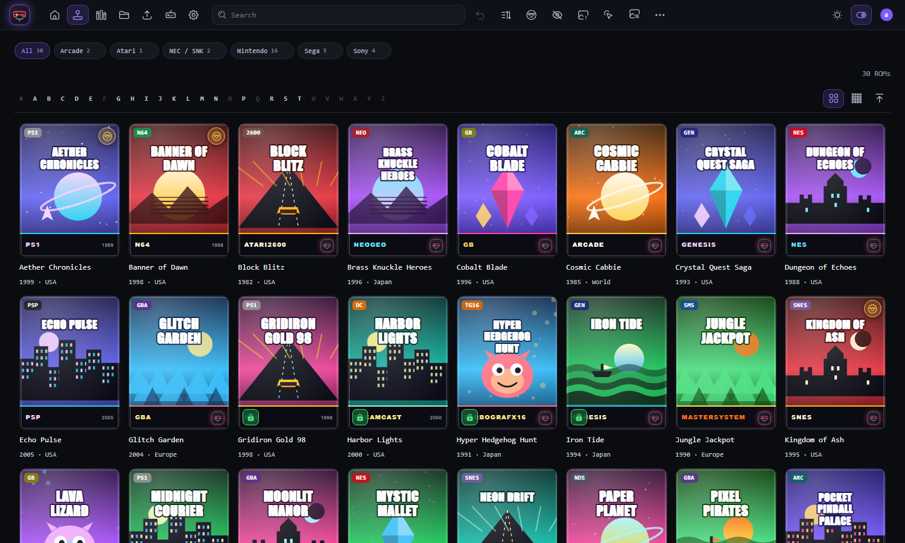
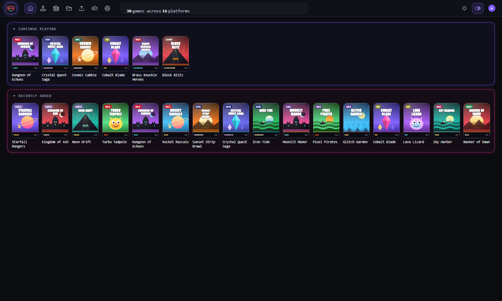
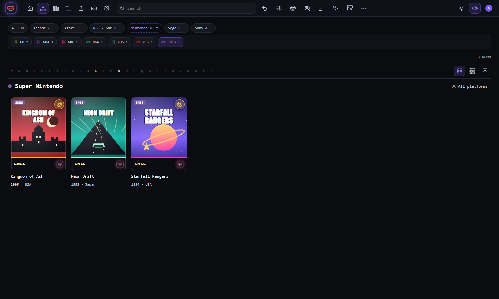
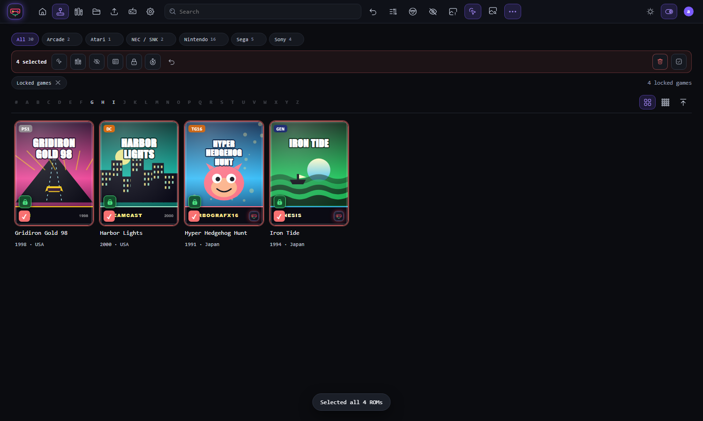
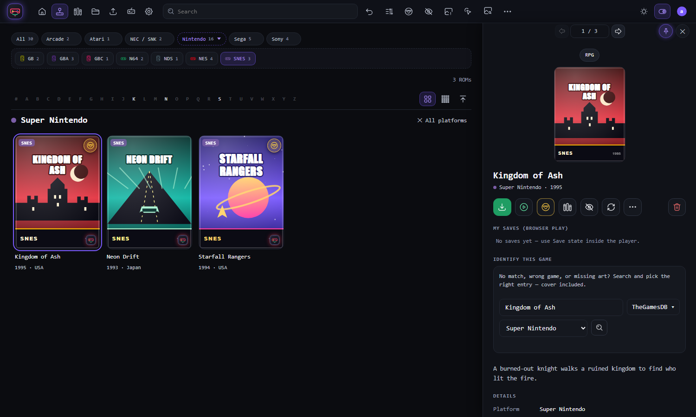
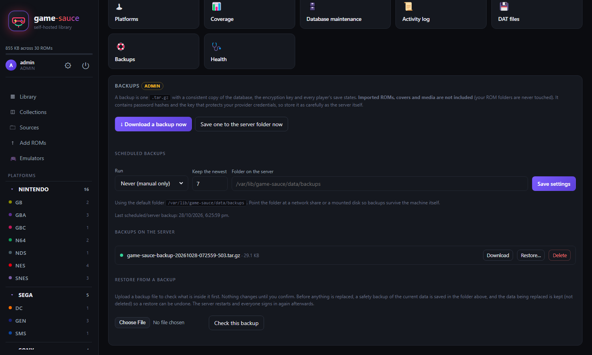
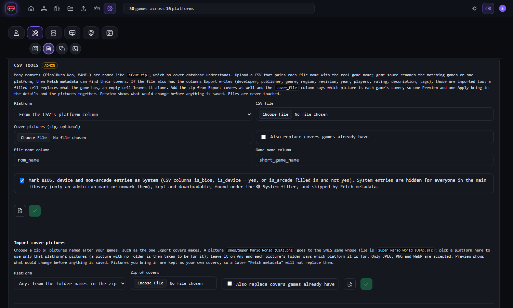

# game-sauce — User Guide

game-sauce is your self-hosted ROM library. It catalogues ROMs where they already live, fetches
covers and details, verifies dumps against No-Intro/Redump DATs, lets you play many older games
in the browser, and lets you download files back out. It is made for a personal or household
library: one admin, plus accounts for the people they trust. This guide covers everyday use. Server
setup lives in [DEPLOYMENT.md](DEPLOYMENT.md).

**Contents:** [Concepts](#1-concepts-read-this-once) · [First run](#2-first-run) ·
[Library](#3-library) · [Game details](#4-game-details) · [Playing in the browser](#5-playing-in-the-browser) ·
[Sources](#6-sources-watch-folders-in-place) · [Add ROMs](#7-add-roms-import-copies) ·
[Metadata](#8-metadata-and-covers) · [MAME](#9-mame) · [DAT files](#10-dat-verification-offline) ·
[Collections](#11-collections-favourites-hidden) · [Emulators](#12-emulators) ·
[Settings](#13-settings) · [Backups and restore](#14-backups-and-restore-admin) ·
[Signing in](#15-signing-in-and-security) · [Controller](#16-using-a-controller) · [Tips](#17-tips-and-limits)

---

## 1. Concepts (read this once)

| Term | Meaning |
|------|---------|
| **Source** | A folder game-sauce watches *in place*. Files stay exactly where they are; a scan records path, size, date and hashes, then fetches metadata. Best for a big collection you already organise. |
| **Add ROMs** | Imports a *copy* into game-sauce (`storage/roms/…`). Your original stays put. Best for one-off additions. |
| **Platform** | Every source is tied to one platform (you pick it; there is no guessing). |
| **Missing** | A file that could not be reached at the last scan (for example an unplugged drive). It is flagged, never deleted, and clears itself on the next scan that finds it. |
| **No source** (orphan) | A catalogue row that belongs to no source folder (a source was removed with "keep ROMs", or a game was locked when its source was removed). Add the folder as a source again and scan: the game is reconnected. Purge what is left. |
| **Locked** | A game marked Keep (padlock). It cannot be deleted until you unlock it. Admins can lock and unlock in bulk. |
| **Needs match** | A ROM no provider has ever matched: your manual-identify worklist. |
| **DAT** | A No-Intro / Redump catalogue of known-good dumps, used to verify ROMs locally. |

Deleting a ROM from the library **never deletes your file** unless you explicitly tick
delete-from-disk. Imported copies in `storage/roms` are removed together with their row.

---

## 2. First run

1. Sign in with the admin account. It is created on first start from `GAMESAUCE_ADMIN_USER` /
   `GAMESAUCE_ADMIN_PASSWORD`, or the installer shows you a generated password. Change the
   password under **⚙ → Change password**.
2. **Sources → Add a folder.** Browse to your ROM folder, pick the **platform** it holds, and add it.
   The scan shows a live progress bar. New games are enriched with metadata as they arrive.
3. Open the **Library**. Covers appear as metadata is fetched.
*(A new admin is walked through steps 4 and 5 by the welcome tour the first time they sign in; **⚙ → My account → Welcome tour** runs it again.)*

4. **⚙ → System setup → Metadata providers:** press **Download database** on the **LaunchBox** card (free, no key, about 110 MB, a minute or two). It is the best first step: it matches by exact name and works offline afterwards. Then add a TheGamesDB key and/or IGDB credentials for better matches
   (ScreenScraper needs developer credentials you request on its forum).
5. Press **Fetch metadata** in the Library and let it run; it works through everything in one go.
6. Set up **backups** (⚙ → Backups) before you do much else. See [section 14](#14-backups-and-restore-admin).

---

## 3. Library

The Library in the Modern look (Classic has the same features with a sidebar):



The Home page, with the ticker, Continue playing and Recently added:



Pick a family, then one or more platforms; the heading names them:



Admins can find locked games, select them all and unlock them in one go:



- **Sidebar:** your name, settings (⚙) and sign out (⏻) sit under the logo. Below are Library,
  Collections, Sources, Add ROMs and Emulators, then every platform with a count, grouped by
  family. Click a platform to filter; it stays selected when you refresh the page.
- **Home page rows:** **Continue playing** (games *you* played in the browser, newest first) and
  **Recently added**. They appear when no filters are active, each in its own neon box: your
  recent games and the newest additions, as many as fit on one line, with no scroll bar. The boxes sit side by
  side on wide screens and stack on narrower ones, with a white divider before the main grid. Click a
  box's heading (▾) to collapse it; the choice is remembered in your browser. On short windows (under
  about 860px high) they start collapsed so the grid keeps its room.
- **Search** matches title, developer, publisher and genre. The **★ Favourites**, **○ Hidden**,
  **▢ No cover**, **⛁ No source**, **🔒 Locked** (admin), **○ Needs match** and **☐ Select** pills sit on the same line as the search box and
  filter the grid. **☐ Select** turns on multi-select. **↺ Reset** (it appears while something is filtering) clears the
  search, the platform choice and every filter in one press; sort order and tile size are kept.
- **Choosing a platform** in the sidebar shows its full name as a heading above the tiles, with
  **✕ All platforms** to go back.
- **Selecting:** **Select all** selects every game matching the current filters (not only the tiles
  on screen). Then add them to a collection or delete them. Check the count before you delete.
- **Tiles** show the cover (or initials), a platform badge and a ▶ button on playable games.
  The grid loads more tiles as you scroll. **Density** switches comfortable / compact.
- **Refreshing the page** keeps your place: section, platform, search, filters, sort and the open
  Settings tile. A fresh sign-in always starts at the Library home.
- **Screen sizes:** the interface scales with the window, from 1080p to 4K.

---

## 4. Game details

Click any tile.



- **‹ 3 / 24 ›** at the top steps to the previous or next game without closing the panel (the
  **←** and **→** keys do the same). It walks the list you opened the game from: the library grid,
  the Recently added or Continue playing row, or a collection.
- **Collection split across drives?** On the Sources page, **＋ Add another folder** on a source adds a second (or third) folder to it: same name, same platform. If one drive is unplugged, its games stay put and the scan tells you which folder it could not read.
- **Pin the details window.** The pin button beside the ✕ keeps a game's details open beside the grid; click another game and it switches. Unpin it to go back to the window that closes when you click away.
- **Actions:** **Download** (hidden for members unless the admin allows it), **▶ Play in browser** (where supported), **Favourite**, **＋ Collection**,
  **Hide**, **Refresh metadata**, **Upload cover**, **Delete**.
- **Browser play: on/off** switches the Play button for this game only. A dot (•) means you have
  overridden the default. This is how you turn off a game that will not start, or turn on one that
  was hidden by the MAME year cut-off.
- **Upload cover** lets you use your own image (JPEG, PNG or WebP, up to 8 MB). The file is checked
  by its content, not its name. Your cover is kept when metadata is refreshed. **↺ Auto cover**
  removes it and goes back to automatic covers.
- **My saves** lists your save states and in-game saves for this game, with a delete button each.
- **Identify this game** searches a provider by title so you can pick the right match and apply
  its cover and details. The ★ in the provider drop-down sets your default provider.
- The detail section lists platform, source, year, developer, hashes, file path, DAT check and more.

---

## 5. Playing in the browser

Games on platforms that need no BIOS (many consoles from the 8-bit and 16-bit eras) have a ▶
button. It runs the game in your browser using [EmulatorJS](https://emulatorjs.org/), loaded from
its CDN while you play; the ROM never leaves your server except to your own browser.

- The player opens full-screen. **✕** closes it. Gamepads work (press a button once inside the frame).
- **Saves are per user and stored on the server.** Use the player's *Save state* button, and
  *Load state* to pick from your saved states (with screenshots). In-game saves (such as RPG save
  slots) are stored automatically about every 30 seconds when they change and are restored when you
  start the game again.
- If a state was made with a different EmulatorJS version you get a ⚠ warning before loading it,
  because it may not restore. Use **Load anyway** to try.
- Platforms that need a BIOS (PlayStation, Saturn, Dreamcast and similar) are not offered. Use a
  desktop emulator from the **Emulators** guide for those.

---

## 6. Sources (watch folders in place)

**Sources → Add a folder:**

1. **Path:** type it or **Browse…**.
2. **Name (optional):** a label only.
3. **Platform:** required. It tells game-sauce what every file in the folder is.
4. **Recursive:** scan subfolders too (on by default).
5. **Add and scan:** a progress bar shows the phase (finding files, importing, fetching metadata),
   a counter such as `312 / 886`, the added / unchanged / failed counts and the current file. If
   you refresh the page during a scan the bar comes back.

Each source card shows its ROM count, size, missing count and last scan, with **↻ Scan**,
**Disable/Enable** (pauses scanning only: the games stay in the library), **Hide games / Show games** (leaves the source's games out of the library, search and counts until you show them again; nothing is deleted) and **Remove** (keep the ROM rows, or remove them too). A scan never aborts
because of one bad file: failures are counted and the first error is reported.

Drives that vanish are flagged **missing**, not deleted. Reconnect and rescan; the flag clears.

---

## 7. Add ROMs (import copies)

1. **Add ROMs →** drop files or a folder into the zone.
2. Choose a platform (or leave auto-detect, which only trusts unambiguous file extensions).
   Untick metadata lookup to skip it.
3. game-sauce hashes each file, skips duplicates ("duplicate of …"), and keeps a copy under
   `storage/roms/<platform>/<sha1>/…`.

---

## 8. Metadata and covers

**⚙ → Metadata providers** (admin) has one card per provider:

| Provider | Needs | Best for |
|----------|-------|----------|
| ScreenScraper | Developer ID + password (forum approval) plus your account | Retro systems, matches by file hash or name |
| TheGamesDB | Free API key | Broad coverage, quick setup |
| IGDB | Twitch Client ID and Secret | Modern systems |
| SteamGridDB | Free API key | Cover art when nothing else has any |

Each card has **Save** and **Test connection**. Credentials are encrypted at rest; set
`GAMESAUCE_SECRET_KEY` to keep the key outside the data folder. Providers are system-wide and
admin-only: members never see them.

- **Fetch metadata** (Library toolbar, admin) walks the whole library 25 games at a time without
  you clicking again. Click the button again to stop. **Fetch missing covers** (⚙ → Library tools → Covers & platform ids) does
  the same for games without art.
- **Identify this game** in the detail panel fixes a wrong or missing match by hand.
- **Clear covers** (⚙ → Database maintenance) removes cover art for one platform, for example after
  a bad batch of matches. It never removes covers you uploaded yourself.

---

## 9. MAME

MAME zips are named for the machine (`sf2.zip`), not the game, so title searches would match the
wrong games. game-sauce handles this in three steps:

1. **Only `.zip` files** are accepted for a MAME source or upload.
2. **Import a name list.** Make one with `mame -listxml > mame.xml` (or use a ProgettoSnaps list),
   then **⚙ → DAT files → Import a DAT** and choose it. Titles, years and developers are applied
   to your MAME games, and new ones are named automatically. Use a list from the same MAME version
   as your romset; games newer than the list keep their zip name.
3. **Fetch metadata.** With real titles, TheGamesDB and IGDB can find covers, and only exact
   title matches with art are accepted so wrong covers are not applied.

**Browser play for MAME is best effort.** The browser core is old, so early arcade games run and
later hardware (Neo Geo, 1990s 3D boards, Cave shooters) mostly does not. By default MAME games
newer than 1990 get no Play button (`GAMESAUCE_MAME_PLAY_MAX_YEAR` changes the year, `9999` turns
the cut-off off). You can override any single game from its detail panel. For everything else, use
desktop MAME.

---

## 10. DAT verification (offline)

A `.dat` lists every known-good dump with its size and hashes. Import one per system
(**⚙ → DAT files**) and game-sauce matches each ROM by SHA1, then CRC32 + size, and marks it
**verified**, **bad** or **variant**. Verified and bad badges show on tiles; games not found in any
DAT show nothing. Canonical titles replace filename guesses unless you edited the title by hand.

**Have / want** shows, per DAT, which entries you own and which you are missing. **Re-match**
re-runs matching after importing new DATs.

---

## 11. Collections, favourites, hidden

- **Collections** group games into sets. Create one in the Collections view, add games from the
  detail panel (**＋ Collection**) or in bulk. A game can be in several collections. Open a
  collection to remove games from it (**✕ Remove**) or delete the collection. Games always stay in
  the library.
- **★ Favourite** is per user.
- **Modern look.** Press ◐ beside the cog (bottom left) to try it; new accounts start in it. It is a personal choice, remembered for your account, and the switch at the right of the bar takes you back to Classic.
  - **Top bar:** page icons, a rolling ticker (the game-sauce name first, then library facts and, for an admin, notices such as an available update), and your avatar menu with the light / dark switch, the retro-font switch and a deeper-black switch.
  - **Library tools** replace the sidebar's controls: search, **reset** (clears search, platform and filters), sort, favourites, hidden, no cover, select, fetch metadata (admin) and **⋯ More filters** (Locked, System items, No source, Needs a match).
  - **Platform chips** along the top: a chip per family, then that family's platforms; click several to combine them. Counts are of what you can see. A play-only account sees only platforms with browser-playable games.
  - **Details window:** icons for download, play, favourite, add to collection, hide and refresh, with more under ⋯. **Pin** it to keep it open beside the games.
  - **Hover words** appear in the app's own font. A button that has no icon yet stays as words.
- **Collections are private.** Each person sees only the collections they made (admins too). A collection card shows up to four covers and a count; **▶** plays a playable game straight from an open collection.
- **Hide** removes a tile from the default view without deleting it; the **○ Hidden** pill shows them. When an **admin** hides a game, members cannot see or open it either: only admins see it again, under Hidden. A member's Hide only affects their own view.

---

## 12. Emulators

The **Emulators** section recommends one emulator per popular platform, with official links, a
BIOS note (none / optional / required), and a **Check latest releases** button. Admins can **Save to
vault** to keep the official installer on your server, or upload one by hand. Anyone signed in can
download from the vault. game-sauce never bundles emulator binaries.

---

## 13. Settings

Click **⚙** under the logo. Members see **Profile picture** (upload your own photo, shown next to your name), **Change password**, **Active sessions** and **Controller**. Admins also get (among others) **CSV tools**, which renames a platform's games from a file-name-to-game-name table before you fetch metadata:

| Tile | What it does |
|------|--------------|
| Metadata providers | Credentials for ScreenScraper, TheGamesDB, IGDB, SteamGridDB |
| User accounts | Create users, set roles, disable accounts, **reset a forgotten password**, the **Let members download ROM files** default, a **Downloads** choice per person (Default / Always allowed / Never), and a **Screen** choice per person: **Full**, or **Play only** (a simple grid of games that can be played in the browser, with search and favourites, and nothing else) |
| Duplicate finder | Finds games you hold in several versions (regions, revisions; never different volumes, discs or numbered sequels), suggests which to keep, and hides the others |
| Platforms | The platform catalogue; add your own |
| Stats | Totals for the library: games, platforms, sources, how many are matched and have covers, orphans, hidden, and the most active user |
| Database maintenance | Orphans, missing files, clear covers by platform |
| Activity log | Who did what, with filters |
| DAT files | Import DATs and MAME name lists; have/want reports |
| Backups | Download, schedule and restore backups |
| Health | Is everything OK? Disk space, database, source folders, last backup, metadata providers. **Copy report** gives a plain-text summary with no passwords, keys or folder paths, handy for bug reports |

Only one tile's panel is open at a time.

---

## 14. Backups and restore (admin)

**⚙ → Backups.**



- **Download a backup now** gives you one `.tar.gz`. **Save one to the server folder now** writes
  it to the server instead. Every backup kept on the server has **Download**, **Restore…** and
  **Delete** buttons.
- **Scheduled backups:** off, every 6 or 12 hours, daily or weekly. Choose how many to keep and the
  folder on the server. Point the folder at a network share or a second disk so a backup survives
  the machine itself.
- **What is inside:** a consistent copy of the database (taken safely while the app runs), the
  encryption key (`secret.key`), every user's saves and a manifest. **Not included:** imported
  ROMs, covers and media. Back up `storage/` separately if you rely on Add ROMs imports.
- **Keep backups safe.** They contain password hashes and the key that protects your provider
  credentials. If you set `GAMESAUCE_SECRET_KEY`, the key is *not* in the backup; store it separately.

**Restoring:**

1. Either click **Restore…** on a backup in the server list, or choose a backup file from your
   computer and click **Check this backup**. The app unpacks it and shows what is inside beside what
   is on the server now, plus any warnings. **Nothing changes yet.**
2. Type `RESTORE` and confirm.
3. A safety backup of the current data is saved first. The server then restarts and swaps the data
   in, and everyone signs in again.
4. The data that was replaced is kept in `data/pre-restore-<time>/`, not deleted, so a restore can
   be undone by hand.

It refuses damaged or half-downloaded files, backups from a newer game-sauce, and backups with no
admin account. The restart needs the server to run under systemd or Docker (the installer does).
Otherwise the page tells you to restart it yourself to finish.

---

## 15. Signing in and security

- The sign-in box **Keep me signed in on this computer** is ticked by default (14 days). Untick it
  on a shared computer: you are signed out when the browser closes, after 12 hours, or after 2
  hours without activity.
- **⚙ → Active sessions** lists where you are signed in and lets you sign others out.
- Admins can create and disable users and reset a forgotten password (**⚙ → User accounts →
  Reset password**; tell the person the new one, and they can change it under **Change password**).
  Non-admins never see sources, DAT tools, providers, user management, backups or the activity log.
- **Members can browse and play, but not download ROM files**, unless the admin allows it: tick **Let
  members download ROM files** under **⚙ → User accounts** for everyone, or use the **Downloads** choice
  on one person's row (**Always allowed** or **Never**, which beat the default). This keeps a shared
  server a household library.
- Keep it on your home network, or reach it through a VPN (WireGuard, Tailscale). It is not meant
  to be exposed to the internet or used as a public ROM site.
- If the app is reachable beyond your home network, put it behind HTTPS and set
  `GAMESAUCE_COOKIE_SECURE=1`. See [DEPLOYMENT.md](DEPLOYMENT.md#6-security-checklist-do-before-exposing-beyond-your-lan).

---

## 16. Using a controller

Plug in or pair a gamepad and press any button. A legend appears at the bottom of the screen.

| Control | Action |
|---------|--------|
| D-pad / left stick | Move the highlight |
| **A** | Select / open |
| **B** | Back (closes a panel or dialog, then returns to the Library) |
| **X** | Play the highlighted game in the browser |
| **Y** | Jump to search |
| **LB / RB** | Previous / next game in the open panel; otherwise previous / next section |

**Which button is A?** Browsers number buttons by position, and Xbox and Nintendo pads label them
differently (Xbox A is at the bottom, Nintendo A is on the right). game-sauce picks the layout from the
controller's name, so a Switch Pro or similar pad puts **A** on the right button. If it guesses wrong,
open **Settings → Controller** and choose Xbox or Nintendo layout; the choice is remembered on that browser.

While a game is running in the player the controller belongs to the game and the interface ignores
it, with one exception: **hold Select + Start for about a second** to close the game. A progress bar
shows while you hold, and no other button is intercepted, so the game never loses a press. Moving the mouse or pressing a key hides the legend. The sign-in screen is not controller-driven.

---

**Platform ids and slugs (admin).** Every platform has a **slug**, its short internal name (lowercase letters and digits, such as `segacd`). Sources, DAT files and the emulator vault all point at it, so it is chosen when you add a platform and cannot be changed afterwards; the form suggests one from the name. A platform can also hold two numbers that are the metadata providers' own codes for that console: a **ScreenScraper id** (needed for ScreenScraper lookups) and a **TheGamesDB id** (narrows TheGamesDB's search to that console). IGDB and LaunchBox need no number: they are matched through the slug. In **Settings > Library tools > Covers & platform ids**, **Verify platform ids** checks your numbers against ScreenScraper's and TheGamesDB's own lists (a provider you have not connected is skipped). It lists platforms with no number, with a number the provider does not know, or with a number that belongs to a different console, suggests the likely one by name, and a **Use** button saves it. Nothing changes until you press Use.

**Platform families (admin).** The groups in the platform chips, the Platforms list and the pickers (Arcade, Nintendo, NEC / SNK...) come from each platform's **Family** field. In Settings > System setup > Platforms, **Rename** on a family heading renames it for all its platforms at once (naming an existing family merges the two); the Family box in Add and Edit suggests the existing names. A family is only a label for grouping: it does not affect metadata lookups, which use the platform's slug and provider numbers. Each family also has a **colour** (the swatch beside its name; **Reset colour** returns the default) that tints its chip in the Modern Library; the platform chips use each platform's own colour from its Edit form. Colours that could not be seen on both the dark and light themes are refused.

**Platform logos (admin).** In Settings > System setup > Platforms > Edit, **Choose logo** adds your own picture to a platform (JPEG, PNG, WebP or SVG, up to 512 KB); **Remove logo** takes it away. game-sauce supplies no logos: use official ones or your own artwork as you see fit. When one platform is chosen in the Library, its logo shows beside the platform name above the grid, in a fixed-size box: the picture is fitted inside it and never stretched, so a large or oddly shaped logo cannot push the layout around. An SVG must be a plain drawing (no scripts or links to other files). If a logo is drawn in black and disappears on the dark theme, tick **Light backing in dark mode** beside it: in dark mode it then sits on a light tile (nothing changes in light mode, and there is no second picture to upload). A **family** can have a logo too (the **Logo** button beside the family's name in the Platforms list): it shows in the same place when two or more platforms of that family are picked, which also suits a family like Arcade with a generic picture.

## 17. Tips and limits

- **Play-only accounts** (set per person under User accounts → Screen) see only games that can be played in the browser, with no downloads, Add ROMs or admin pages. An admin can preview this from the avatar menu (Preview play-only).

- A short unique word finds a game faster than a full filename.
- **Needs match** plus **Fetch metadata** is the loop: enrich everything, then hand-match the leftovers.
- Filename tags in `(...)` / `[...]` are read for region and revision.
- Enrichment runs one game at a time with gaps because providers rate-limit.
- Covers are cached in `storage/media`; deleting a game deletes its cached art.
- The DAT import limit is 512 MB (`GAMESAUCE_MAX_DAT`); a MAME list of about 400 MB fits.
- The animated sign-in background switches itself off if your system asks for reduced motion.

## Exporting your game data

Settings > Library tools > CSV tools (admin) has an **Export your game data** box. Pick a platform (or all), then **Export games (CSV)** for one row per game with its file name, title, platform, where the file lives, the editable details and the checksums, or **Export covers (zip)** for the cover pictures, each named after its game's file so they pair up with the CSV rows. Nothing on the server is changed. The first two columns (`rom_name`, `short_game_name`) are what the import above reads, so you can fix names in a spreadsheet and import the file again.

### Bringing an export back

The CSV import reads every column the export writes, so you can edit titles, developers, genres, years, descriptions or tags in a spreadsheet and import the file again (a filled cell replaces what the game has; an empty cell leaves it alone). To bring covers back, use **Import cover pictures** in the same panel with the zip from **Export covers**: each picture goes to the game with the matching file name on the matching platform. Preview shows what would change, and games that already have a cover are skipped unless you tick the box. Only JPEG, PNG and WebP pictures are accepted.



To bring in details and covers in one go, choose the CSV and add the zip from **Export covers** in the **Cover pictures (zip)** box of the same import. The CSV's `cover_file` column names the picture for each game, so the pictures do not have to be named after the games' files. One Preview shows both parts, and one Apply saves them.

**Locked games.** A game locked with Keep (from the duplicate finder or the details window) cannot be deleted. To clear a batch of them, open the **Locked** filter, choose Select, Select all, then **Unlock**. They are then ordinary games and can be deleted. Admins only.

## Digital: your Steam, PlayStation, Nintendo and Xbox games

Under **Settings → My account → Steam** each person can show the games they own on Steam, with their hours played, on the **Digital** page. Only you see your list.

1. Get a Web API key at steamcommunity.com/dev/apikey (any domain name will do).
2. Find your 17-digit Steam ID (steamid.io shows it) or copy your steamcommunity.com/profiles/... link.
3. In Steam, set Profile → Edit profile → Privacy settings → **Game details** to **Public**. Without that Steam returns nothing.
4. Paste both into game-sauce, press **Save**, then **Fetch my games**.

The play button on a tile opens the game in Steam (`steam://rungameid/...`). That only works in a browser on a PC that has Steam installed, and the browser asks permission the first time. game-sauce never downloads or changes anything on Steam. **Remove** deletes your key and list from game-sauce.
### PlayStation, Nintendo and Xbox games (from a CSV)

There is no store login to read console libraries from, so an admin can bring them in from a CSV under **Settings → Library tools → CSV tools → Import console games into Digital**. The games go into that person's own Digital list, beside the Steam games, with one chip each for PlayStation, Nintendo and Xbox. Every tile is badged with its console: PS3, PS4 or PS5; SWITCH 2, SWITCH, WII, WII U, 3DS or DS; XBOX, XBOX 360, XBOX ONE or X|S.

The CSV needs a header row with these columns (any order; the country is optional):

```
Platform,Game,Country
PS5,Astro Bot,Australia
PlayStation 4,Ratchet & Clank,AU
PS3,Uncharted 2: Among Thieves,AU
Switch 2,Mario Kart World,AU
Switch,Animal Crossing: New Horizons,United States
Wii U,Super Mario 3D World,AU
3DS,Fire Emblem Awakening,AU
DS,Pokémon Black,AU
Xbox Series X|S,Halo Infinite,United States
Xbox One,Forza Horizon 5,Australia
Xbox 360,Halo 3,AU
Xbox,Halo: Combat Evolved,AU
```

- **Platform**: `PS3`, `PS4`, `PS5` (or `PlayStation 4` and so on), `Switch 2`, `Switch`, `Wii`, `Wii U`, `3DS`, `DS`, `Xbox`, `Xbox 360`, `Xbox One` or `Xbox Series X|S`. Other platforms are skipped and listed in the result. The same title on two consoles is two games. (The older column names Platform Name, Game Title and Country of Source Store still work.)
- **Country**: a country name or its two letters. It is shown in the details window, and the store button opens that country's PlayStation or Xbox Store (Nintendo games have no store button).

Press **Preview** to see what would change, then **Import games**. Importing the same file again adds nothing twice; tick **Remove games no longer in the file** to make the list match the file (only for the platforms the file lists).

Details and covers are looked up in the background with the providers under **Settings → Metadata providers** (as for the Library). The Digital page shows progress while it runs. Console games have no play button. A game whose details were not found can be tried again with **Refresh** on the Digital page, and any console game can be taken out of the list with the bin button in its details window.

